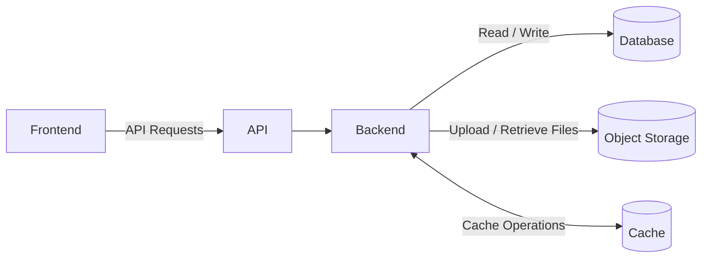
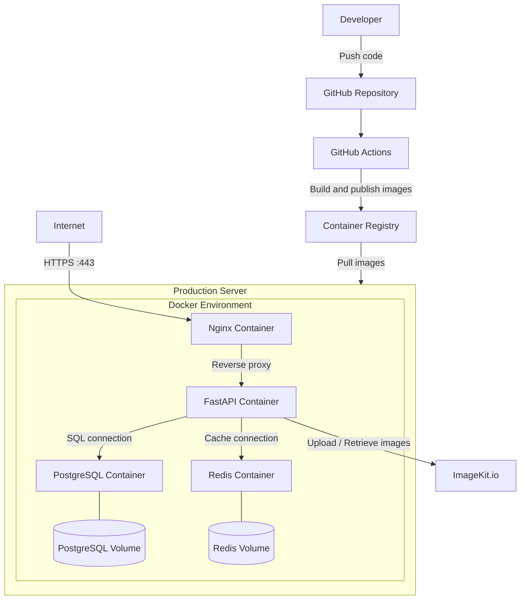

# Architecture Overview

## System Components


## Production Deployment


## Internal Backend Architecture

```mermaid
flowchart TB
    Client[Client] --> Middleware

    subgraph Middleware[Middleware Pipeline]
        direction TB
        CORS[CORS Middleware]
        LoggingPerformance[Logging & Performance Middleware]
        Security[Security Headers Middleware]
        RateLimit[Rate Limiting Middleware]

        CORS --> LoggingPerformance
        LoggingPerformance --> Security
        Security --> RateLimit
    end

    Middleware --> MainRouter[Central Router - main.py]

    subgraph Backend[FastAPI Backend]
        MainRouter --> ModuleRouters

        subgraph ModuleRouters[Module Routers]
            ProductRouter[Products Router]
            CategoryRouter[Categories Router]
            UserRouter[Users Router]
            OrderRouter[Orders Router]
            CartRouter[Carts Router]
            ReviewRouter[Reviews Router]
            WishlistRouter[Wishlists Router]
            AuthRouter[Auth Router]
        end

        subgraph Modules[Module Layers]
            ProductRouter --> ProductService[Product Service]
            CategoryRouter --> CategoryService[Category Service]
            UserRouter --> UserService[User Service]
            OrderRouter --> OrderService[Order Service]
            CartRouter --> CartService[Cart Service]
            ReviewRouter --> ReviewService[Review Service]
            WishlistRouter --> WishlistService[Wishlist Service]
            AuthRouter --> AuthService[Auth Service]

            ProductService --> ProductRepository[Product Repository]
            CategoryService --> CategoryRepository[Category Repository]
            UserService --> UserRepository[User Repository]
            OrderService --> OrderRepository[Order Repository]
            CartService --> CartRepository[Cart Repository]
            ReviewService --> ReviewRepository[Review Repository]
            WishlistService --> WishlistRepository[Wishlist Repository]
            AuthService --> UserRepository
        end
    end

    ProductRepository --> PostgreSQL[(PostgreSQL)]
    CategoryRepository --> PostgreSQL
    UserRepository --> PostgreSQL
    OrderRepository --> PostgreSQL
    CartRepository --> PostgreSQL
    ReviewRepository --> PostgreSQL
    WishlistRepository --> PostgreSQL

    subgraph SharedServices[Shared Infrastructure]
        Cache[Cache Service]
        Email[Email Service]
        Logger[Logging System]
    end

    Modules --> SharedServices
    Cache <--> Redis[(Redis)]
    Email --> EmailProvider[Email Provider]
    LoggingPerformance --> Logger
    Backend --> Logger