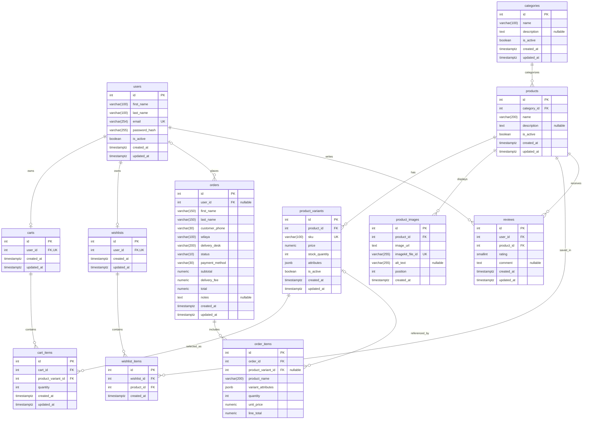

# Database overview
## Entity–relationship diagram

`||` denotes exactly one, `o|` zero or one, and `o{` zero or more. Each order item must reference one order, but the schema permits orders with no items. `imagekit_file_id` is non-null and unique in the actual model and migration.

## Entity responsibilities

| Entity | Responsibility |
|---|---|
| `users` | Registered account identity, credentials, activation, timestamps. |
| `categories` | Product classification and activation. |
| `products` | Catalog item identity, category, description, activation. |
| `product_variants` | SKU-specific price, stock, JSONB attributes, and activation. |
| `product_images` | Product image URL, ImageKit file ID, alt text, ordering, creation time. |
| `carts` | At most one persisted cart per registered user. |
| `cart_items` | Variant and quantity entries in a registered user's cart. |
| `wishlists` | At most one wishlist per registered user. |
| `wishlist_items` | Products saved in a wishlist. |
| `orders` | Checkout, customer/delivery snapshots, status, payment method, and totals. |
| `order_items` | Purchased-item snapshots and optional link to a current variant. |
| `reviews` | User product rating and optional comment. |

## Relationships and deletion policy

| Parent | Child | Foreign key | Nullable? | `ON DELETE` |
|---|---|---|---|---|
| `users` | `carts` | `carts.user_id` | No | `CASCADE` |
| `users` | `wishlists` | `wishlists.user_id` | No | `CASCADE` |
| `users` | `orders` | `orders.user_id` | Yes | `SET NULL` |
| `users` | `reviews` | `reviews.user_id` | No | `CASCADE` |
| `categories` | `products` | `products.category_id` | No | `RESTRICT` |
| `products` | `product_variants` | `product_variants.product_id` | No | `RESTRICT` |
| `products` | `product_images` | `product_images.product_id` | No | `CASCADE` |
| `products` | `wishlist_items` | `wishlist_items.product_id` | No | `RESTRICT` |
| `products` | `reviews` | `reviews.product_id` | No | `RESTRICT` |
| `carts` | `cart_items` | `cart_items.cart_id` | No | `CASCADE` |
| `product_variants` | `cart_items` | `cart_items.product_variant_id` | No | `RESTRICT` |
| `wishlists` | `wishlist_items` | `wishlist_items.wishlist_id` | No | `CASCADE` |
| `orders` | `order_items` | `order_items.order_id` | No | `RESTRICT` |
| `product_variants` | `order_items` | `order_items.product_variant_id` | Yes | `SET NULL` |

ORM behavior supplements these actions: cart and wishlist contents use delete-orphan cascades; product images use delete-orphan; order items have no delete cascade and `Order.items` uses `passive_deletes="all"`, leaving the database `RESTRICT` rule to reject order deletion when items exist. User deletion cascades to its cart, wishlist, and reviews in the ORM as well; order rows are retained and detached by the nullable FK.

## Important constraints and indexes

| Table | Unique constraints / indexes | Check constraints |
|---|---|---|
| `users` | Unique index on `email` (`ix_users_email`; case-sensitive) | — |
| `categories` | — | — |
| `products` | Index `ix_products_category_id` | — |
| `product_variants` | Unique `sku`; index `ix_product_variants_product_id` | `price >= 0`; `stock_quantity >= 0` |
| `product_images` | Unique `imagekit_file_id`; index `(product_id, position)` | `position >= 0` |
| `carts` | Unique `user_id` | — |
| `cart_items` | Unique `(cart_id, product_variant_id)`; index `product_variant_id` | `quantity > 0` |
| `wishlists` | Unique `user_id` | — |
| `wishlist_items` | Unique `(wishlist_id, product_id)`; index `product_id` | — |
| `orders` | Indexes `(user_id, created_at)` and `(status, created_at)` | COD-only payment method; amounts nonnegative; `total = subtotal + delivery_fee`; generated status check for the six `OrderStatus` values |
| `order_items` | Indexes `order_id`, `product_variant_id` | `quantity > 0`; amounts nonnegative; `line_total = quantity * unit_price` |
| `reviews` | Unique `(user_id, product_id)`; index `product_id` | `rating BETWEEN 1 AND 5` |

## Design notes

- `orders.user_id` is nullable, supporting guest checkout in the schema. Recipient name, phone, wilaya, and delivery desk are stored on the order; deleting a user sets the FK to null.
- `order_items` stores product name, variant attributes, quantity, unit price, and line total as historical snapshots. Its variant link is nullable and becomes null if the variant is deleted.
- Products and variants have `is_active`; categories also have `is_active`. These columns represent deactivation state; they do not themselves enforce an application deletion policy.
- `product_images` stores `image_url` and a required unique `imagekit_file_id`; image assets themselves are external to PostgreSQL. The schema does not implement external asset lifecycle operations.
- Guest carts are not represented by a separate table; the schema only has carts tied to users.